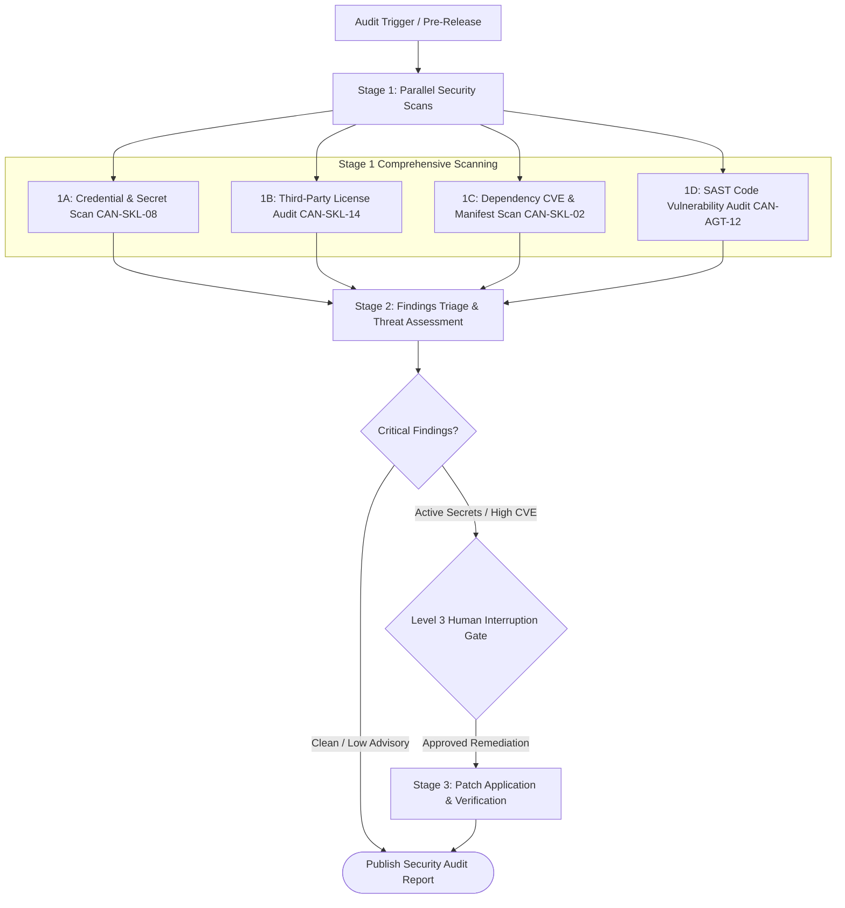

# Workflow: application-security-and-vulnerability-audit (CAN-WFL-08)

## 1. Purpose & Applicable Scenarios
- **Purpose**: Systematically inspects codebases for security vulnerabilities, hardcoded credentials, third-party CVEs, and open-source license compliance risks.
- **When to Use**: Pre-release security gates, pre-commit secret audits, third-party dependency evaluations, or vulnerability remediation cycles.
- **When NOT to Use**: Routine UI styling or non-sensitive documentation updates.

## 2. Entry Conditions & Required Inputs
- **Entry Conditions**: Scheduled security audit, new external package introduction, or security review directive.
- **Required Inputs**: Source code files, dependency manifests, lockfiles, configuration files.

## 3. Participating Agents & Skill Mapping

| Agent ID | Agent Name | Role in Workflow | Mapped Skills Used |
|:---:|---|---|---|
| `CAN-AGT-01` | `orchestrator` | Initiating security scan, evaluating findings, enforcing human gates | `human-interruption-gateway` |
| `CAN-AGT-12` | `security-auditor` | Secret scanning, SAST analysis, license audit, threat modeling | `security-secret-scanner`, `license-attribution-auditor`, `semantic-code-search` |
| `CAN-AGT-14` | `devops-platform` | Patching vulnerable dependency versions in lockfiles | `project-dependency-analyzer`, `git-atomic-committer` |
| `CAN-AGT-09` | `code-reviewer` | Reviewing security remediation diffs | `ast-syntax-verifier` |

## 4. Execution Stages & Dependency Graph

### Stage-by-Stage Breakdown
- **Stage 1: Comprehensive Scanning (Mandatory)**
  - *Lead*: `security-auditor`
  - *Action*: Concurrently executes secret scanning (`security-secret-scanner`), license compliance checking (`license-attribution-auditor`), and SAST vulnerability analysis.
- **Stage 2: Findings Triage & Threat Assessment (Mandatory)**
  - *Lead*: `security-auditor`
  - *Action*: Triages findings into Critical, High, Medium, and Low severities. Compiles actionable remediation steps.
- **Stage 3: Remediation & Patch Application (Conditional)**
  - *Lead*: `devops-platform` or `backend-engineer`
  - *Condition*: Mandatory if vulnerabilities or copyleft risks are found; skipped if audit reports green.
  - *Action*: Updates vulnerable package versions in lockfiles or remediates code flaws.
- **Stage 4: Verification (Mandatory)**
  - *Lead*: `security-auditor` and `code-reviewer`
  - *Action*: Re-scans patched files to ensure vulnerabilities are neutralized.

## 5. Parallel Execution Opportunities & Dynamic Adaptation
- **Parallel Scanning**: Secret scanning (1A), license auditing (1B), manifest CVE checks (1C), and SAST code inspection (1D) execute concurrently in Stage 1.
- **Specialist Skipping**: If audit is clean with zero vulnerabilities, Stage 3 (remediation) and `devops-platform` are omitted from the execution DAG.
- **Dynamic Scoping**: Audits on pull request diffs scan only modified files, while pre-release audits scan the entire repository.

## 6. Handoffs, Blockers & Escalation Pathways
- **CAN-ENV-01 v2.2 Communication Protocol**: All handoffs, stage transitions, status updates, and task delegations pass strictly through `orchestrator` (`CAN-AGT-01`) using `CAN-ENV-01 v2.2` envelopes. No direct peer-to-peer agent bypass is permitted.
- **Blockers & Clarifications**: If license metadata is ambiguous in upstream packages, `security-auditor` emits `CLARIFICATION_REQUEST` to `CAN-AGT-01`.
- **Dynamic Task Reassignment**: If dependency bump breaks downstream tests, `CAN-AGT-01` reassigns compatibility fix to `backend-engineer`.
- **Human Approval Escalation**: Any discovered active API token, private key, or database password MUST immediately halt execution, emit a `BLOCKER` envelope, and trigger the Level 3 4-quadrant human approval gate.

## 7. Applicable Conditional Quality Gates
- **Secret Scan Gate**: Zero unredacted credentials or private keys.
- **License Gate**: 100% compliance with permitted open-source licenses (MIT, Apache 2.0, BSD).
- **SAST Gate**: Zero unaddressed Critical or High security vulnerabilities.

## 8. Expected Outputs & Completion Criteria
- **Deliverables**: Security Audit Report, Secret Scan log, License Compliance Inventory, vulnerability remediation diffs.
- **Completion Criteria**: Zero secret leaks; zero copyleft license violations; all critical CVEs resolved.
