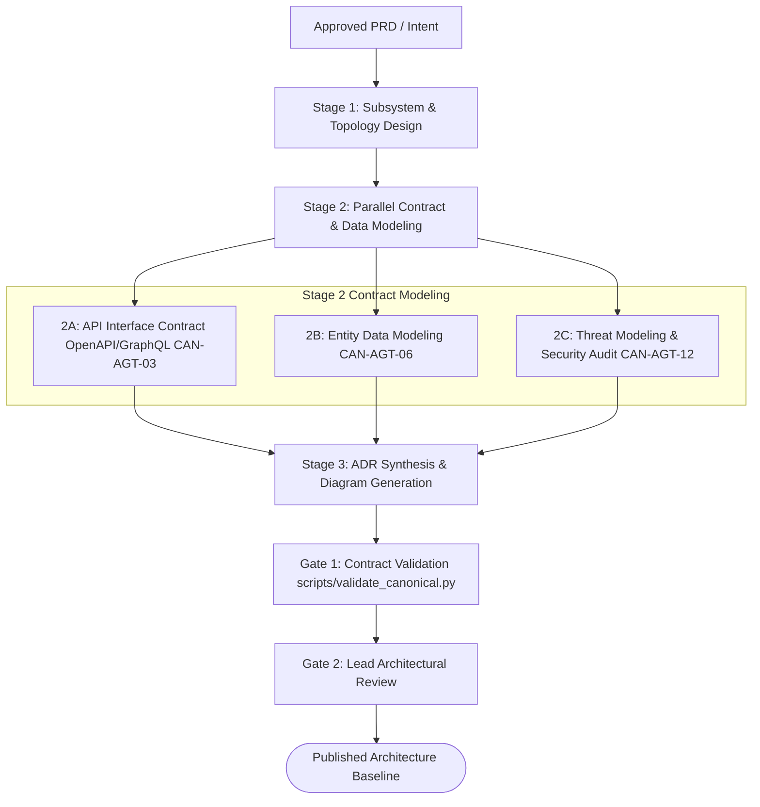

# Workflow: architecture-decision-and-system-design (CAN-WFL-05)

## 1. Purpose & Applicable Scenarios
- **Purpose**: Establishes formal, decoupled technical architectures and machine-validatable interface contracts for new modules or complex multi-agent features.
- **When to Use**: Greenfield project initialization, major subsystem redesigns, or breaking API contract updates.
- **When NOT to Use**: Localized bug repairs (use `CAN-WFL-02`) or routine minor endpoint updates.

## 2. Entry Conditions & Required Inputs
- **Entry Conditions**: Approved PRD, business capability requirement, or major refactoring directive.
- **Required Inputs**: User stories, functional requirements, existing architectural documents.

## 3. Participating Agents & Skill Mapping

| Agent ID | Agent Name | Role in Workflow | Mapped Skills Used |
|:---:|---|---|---|
| `CAN-AGT-01` | `orchestrator` | Initiating design cycle, reviewing architectural proposals, gating release | `ast-symbol-extractor` |
| `CAN-AGT-02` | `product-analyst` | Validating functional requirements and edge-case behaviors | `documentation-synthesizer` |
| `CAN-AGT-03` | `system-architect` | Designing topologies, authoring ADRs, producing OpenAPI/GraphQL schemas | `documentation-synthesizer`, `api-contract-validator`, `ast-symbol-extractor` |
| `CAN-AGT-06` | `database-specialist` | Designing entity-relationship models and persistence topology | `surgical-code-editor` |
| `CAN-AGT-12` | `security-auditor` | Threat modeling, authentication boundary verification, OWASP checks | `security-secret-scanner` |

## 4. Execution Stages & Dependency Graph

### Stage-by-Stage Breakdown
- **Stage 1: Subsystem Topology Design (Mandatory)**
  - *Lead*: `system-architect`
  - *Action*: Deconstructs requirements into decoupled subsystems and defines service boundaries.
- **Stage 2: Parallel Contract & Data Modeling (Mandatory)**
  - *Lead*: `system-architect`, `database-specialist`, `security-auditor`
  - *Action*: Concurrently defines API interface contracts (OpenAPI/GraphQL), entity models, and threat boundaries.
- **Stage 3: ADR Synthesis & Mermaid Diagramming (Mandatory)**
  - *Lead*: `system-architect`
  - *Action*: Authors formal ADRs and creates Mermaid class and sequence diagrams.
- **Stage 4: Validation & Review (Mandatory)**
  - *Lead*: `system-architect` and `orchestrator`
  - *Action*: Validates contract schemas via `api-contract-validator`.

## 5. Parallel Execution Opportunities & Dynamic Adaptation
- **Parallel Modeling**: API interface definition (2A), database entity modeling (2B), and threat modeling (2C) run concurrently once subsystem boundaries are established.
- **Specialist Skipping**: If system change involves no persistence layer, `database-specialist` is omitted from the DAG. If purely internal logic with no public endpoints, `security-auditor` can be skipped.
- **Dynamic Reordering**: If data models are already fixed, Stage 2B finishes early and informs API contracts in Stage 2A.

## 6. Handoffs, Blockers & Escalation Pathways
- **CAN-ENV-01 v2.2 Communication Protocol**: All handoffs, stage transitions, status updates, and task delegations pass strictly through `orchestrator` (`CAN-AGT-01`) using `CAN-ENV-01 v2.2` envelopes. No direct peer-to-peer agent bypass is permitted.
- **Blockers & Clarifications**: If requirements in Stage 1 contain conflicting functional specs, `system-architect` emits `CLARIFICATION_REQUEST` to `CAN-AGT-01`, which routes it to `product-analyst` or the user.
- **Dynamic Task Reassignment & Cancellation**: If architectural feasibility fails, `CAN-AGT-01` cancels downstream modeling and reassigns exploration to `research-investigator`.
- **Human Approval Escalation**: Any breaking interface change or architectural topology shift triggers a Level 3 4-quadrant human approval gate before ADR adoption.

## 7. Applicable Conditional Quality Gates
- **Contract Schema Gate**: Interface schemas must validate cleanly via `api-contract-validator`.
- *Skipped Gates*: Unit test runners, browser test suites (documentation/specification phase).

## 8. Expected Outputs & Completion Criteria
- **Deliverables**: Validated OpenAPI/JSON Schema contracts, Architecture Decision Records (ADRs), Mermaid diagrams.
- **Completion Criteria**: Schemas pass static validation; ADRs approved by Orchestrator.
