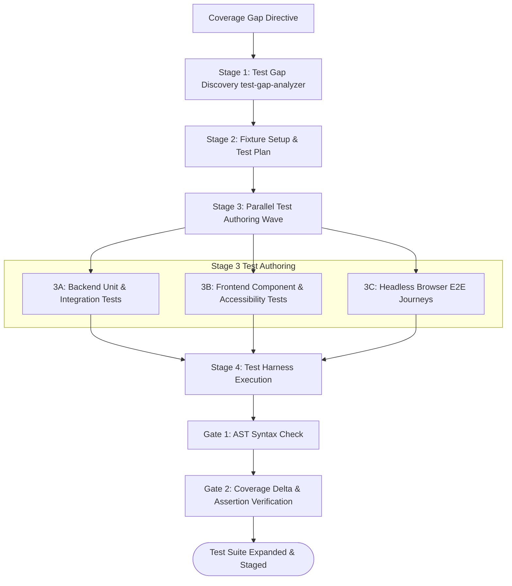

# Workflow: automated-test-suite-expansion (CAN-WFL-09)

## 1. Purpose & Applicable Scenarios
- **Purpose**: Systematically increases test coverage, eliminates regression blind spots, authors missing unit/integration tests, and verifies edge-case resilience.
- **When to Use**: Post-feature test hardening, auditing code coverage gaps, regression test expansion, or test suite maintenance.
- **When NOT to Use**: Implementing core application features from scratch (use `CAN-WFL-01`).

## 2. Entry Conditions & Required Inputs
- **Entry Conditions**: Existing application code, acceptance criteria, or coverage gap directive.
- **Required Inputs**: Source files, test directories, coverage configuration files.

## 3. Participating Agents & Skill Mapping

| Agent ID | Agent Name | Role in Workflow | Mapped Skills Used |
|:---:|---|---|---|
| `CAN-AGT-01` | `orchestrator` | Initiating test expansion, evaluating coverage thresholds | `human-interruption-gateway` |
| `CAN-AGT-11` | `qa-engineer` | Coverage gap analysis, authoring test suites, running test harnesses | `test-gap-analyzer`, `ephemeral-test-server`, `headless-browser-runner`, `git-atomic-committer` |
| `CAN-AGT-04` | `backend-engineer` | Providing domain insights on backend edge cases | `ast-syntax-verifier` |
| `CAN-AGT-05` | `frontend-engineer` | Providing component interaction expectations | `ast-syntax-verifier` |
| `CAN-AGT-10` | `syntax-verifier` | Validating syntax of authored test files | `ast-syntax-verifier` |
| `CAN-AGT-09` | `code-reviewer` | Reviewing test quality and edge-case adequacy | `ast-syntax-verifier` |

## 4. Execution Stages & Dependency Graph

### Stage-by-Stage Breakdown
- **Stage 1: Test Gap Discovery (Mandatory)**
  - *Lead*: `qa-engineer` via `test-gap-analyzer`
  - *Action*: Identifies untested execution paths, uncovered error handlers, and missing edge cases.
- **Stage 2: Fixture Setup & Test Planning (Mandatory)**
  - *Lead*: `qa-engineer`
  - *Action*: Sets up shared mock fixtures, factory helpers, and deterministic test data.
- **Stage 3: Parallel Test Authoring Wave (Mandatory)**
  - *Lead*: `qa-engineer`
  - *Action*: Concurrently authors unit tests, component tests, and E2E browser journeys (`headless-browser-runner`).
- **Stage 4: Test Harness Execution & Coverage Verification (Mandatory)**
  - *Lead*: `qa-engineer`
  - *Action*: Executes test suites using `ephemeral-test-server` for web applications. Verifies coverage metric increases.

## 5. Parallel Execution Opportunities & Dynamic Adaptation
- **Parallel Authoring**: Unit tests (3A), component tests (3B), and E2E browser tests (3C) are authored concurrently once fixtures are established.
- **Specialist Skipping**: If targeted codebase is pure backend API, `frontend-engineer` and `headless-browser-runner` are omitted from the DAG.
- **Dynamic Reordering**: If fast unit tests can run without full mock servers, they execute immediately while complex integration fixtures are configured.

## 6. Handoffs, Blockers & Escalation Pathways
- **CAN-ENV-01 v2.2 Communication Protocol**: All handoffs, stage transitions, status updates, and task delegations pass strictly through `orchestrator` (`CAN-AGT-01`) using `CAN-ENV-01 v2.2` envelopes. No direct peer-to-peer agent bypass is permitted.
- **Blockers & Clarifications**: If ambiguous business logic makes expected test assertions unclear, `qa-engineer` emits `CLARIFICATION_REQUEST` to `CAN-AGT-01`.
- **Production Defect Discovery**: If writing new tests exposes an existing production bug, `qa-engineer` emits `BLOCKER`, pausing test authoring and routing bug fix to `CAN-WFL-02`.
- **Dynamic Task Reassignment**: If specialized test harness setup requires platform configuration, `CAN-AGT-01` reassigns harness setup to `devops-platform`.
- **Human Approval Escalation**: If tests require external API credentials or integration with live third-party staging services, `CAN-AGT-01` halts execution for human approval.

## 7. Applicable Conditional Quality Gates
- **Syntax Gate**: Authored test files must pass `ast-syntax-verifier`.
- **Pass Gate**: 100% of newly authored and existing tests must pass with zero flakiness.
- **Coverage Delta Gate**: Net test coverage must increase or remain neutral; no coverage regressions.

## 8. Expected Outputs & Completion Criteria
- **Deliverables**: New automated test files, test fixtures, coverage delta report, test pass logs.
- **Completion Criteria**: 100% test pass rate across new and existing tests; identified coverage gaps closed.
