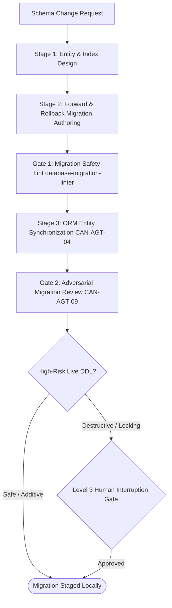

# Workflow: database-schema-and-migration-lifecycle (CAN-WFL-06)

## 1. Purpose & Applicable Scenarios
- **Purpose**: Governs database structural evolution, ensuring migrations are zero-downtime, fully reversible, free of table locks, and optimized for queries.
- **When to Use**: Adding tables, adding columns, modifying indexes, altering schemas, or performing database refactoring.
- **When NOT to Use**: Routine application code edits that touch zero database structures.

## 2. Entry Conditions & Required Inputs
- **Entry Conditions**: Data model requirements, entity specification, or query performance optimization ticket.
- **Required Inputs**: Existing migration files, database schema definitions, target database dialect.

## 3. Participating Agents & Skill Mapping

| Agent ID | Agent Name | Role in Workflow | Mapped Skills Used |
|:---:|---|---|---|
| `CAN-AGT-01` | `orchestrator` | Dispatching migration, enforcing human gate for high-risk DDL | `human-interruption-gateway` |
| `CAN-AGT-06` | `database-specialist` | Writing migrations, index optimization, rollback validation | `database-migration-linter`, `surgical-code-editor`, `ast-syntax-verifier` |
| `CAN-AGT-04` | `backend-engineer` | Synchronizing ORM entities and database access repositories | `surgical-code-editor`, `ast-syntax-verifier` |
| `CAN-AGT-10` | `syntax-verifier` | Syntax validation of SQL / ORM files | `ast-syntax-verifier` |
| `CAN-AGT-09` | `code-reviewer` | Reviewing migration diffs and rollback logic | `ast-syntax-verifier` |

## 4. Execution Stages & Dependency Graph

### Stage-by-Stage Breakdown
- **Stage 1: Schema & Index Design (Mandatory)**
  - *Lead*: `database-specialist`
  - *Action*: Models entity structures, foreign keys, and indexes ensuring optimal query execution plans.
- **Stage 2: Forward & Rollback Migration Authoring (Mandatory)**
  - *Lead*: `database-specialist`
  - *Action*: Authors forward migration script and matching reversible `down()` rollback script.
- **Stage 3: Migration Safety Linting (Mandatory Gate 1)**
  - *Lead*: `database-specialist` via `database-migration-linter`
  - *Action*: Lints DDL for locking operations (`NOT NULL` without default, full table rewrites, unindexed foreign keys).
- **Stage 4: ORM Synchronization (Conditional)**
  - *Lead*: `backend-engineer`
  - *Condition*: Mandatory if backend uses ORM entities (Prisma, SQLAlchemy, TypeORM); skipped for raw SQL setups.
  - *Action*: Synchronizes backend entity classes with the new database schema.
- **Stage 5: Review & Human Approval (Mandatory)**
  - *Lead*: `code-reviewer` and `orchestrator`
  - *Action*: Reviews migration diff; if live database execution or destructive DDL is required, triggers Level 3 Human Gate.

## 5. Parallel Execution Opportunities & Dynamic Adaptation
- **Parallel Authoring**: Forward and rollback migration scripts are authored concurrently by `database-specialist`.
- **Specialist Skipping**: If project does not use an ORM (e.g. raw SQL scripts only), `backend-engineer` is omitted from the DAG.
- **Dynamic Reordering**: If migration safety lint fails in Stage 3, ORM synchronization is paused until migration scripts are revised.

## 6. Handoffs, Blockers & Escalation Pathways
- **CAN-ENV-01 v2.2 Communication Protocol**: All handoffs, stage transitions, status updates, and task delegations pass strictly through `orchestrator` (`CAN-AGT-01`) using `CAN-ENV-01 v2.2` envelopes. No direct peer-to-peer agent bypass is permitted.
- **Blockers & Clarifications**: If ambiguous foreign key constraints or column types arise, `database-specialist` emits `CLARIFICATION_REQUEST` to `CAN-AGT-01`.
- **Locking Violations**: If `database-migration-linter` detects unsafe table locks, `database-specialist` emits `BLOCKER` to `CAN-AGT-01` and adopts safe multi-step alternatives (e.g. add nullable column, backfill, alter not null).
- **Human Approval Escalation**: Any `DROP TABLE`, `DROP COLUMN`, or table-locking operation MUST halt execution and present the Level 3 4-quadrant human approval gate before staging.

## 7. Applicable Conditional Quality Gates
- **Migration Safety Gate**: Zero lock hazards via `database-migration-linter`.
- **Rollback Gate**: Rollback script must exist and be syntactically verified.
- **Code Review Gate**: Adversarial review of SQL/ORM changes.

## 8. Expected Outputs & Completion Criteria
- **Deliverables**: Forward migration file, rollback migration file, updated ORM entities, migration lint report.
- **Completion Criteria**: Lint clean with zero lock warnings; rollback script verified; ORM compiles cleanly.
