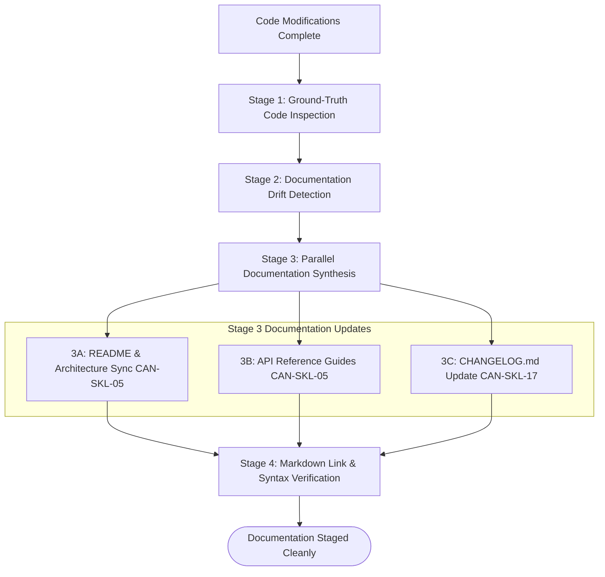

# Workflow: documentation-and-drift-remediation (CAN-WFL-07)

## 1. Purpose & Applicable Scenarios
- **Purpose**: Eliminates documentation drift by inspecting active code implementations and updating README files, API guides, tutorials, and changelogs.
- **When to Use**: Post-feature delivery documentation updates, milestone closure, release preparation, or documentation drift audits.
- **When NOT to Use**: Writing code or modifying application features.

## 2. Entry Conditions & Required Inputs
- **Entry Conditions**: Completed milestone deliverables, code modifications, or routine documentation synchronization directive.
- **Required Inputs**: Active source code, git commit logs, existing documentation files.

## 3. Participating Agents & Skill Mapping

| Agent ID | Agent Name | Role in Workflow | Mapped Skills Used |
|:---:|---|---|---|
| `CAN-AGT-01` | `orchestrator` | Initiating doc synchronization, reviewing generated changelogs | `ast-symbol-extractor` |
| `CAN-AGT-15` | `docs-technical-writer` | Ground-truth code inspection, documentation updates, changelog generation | `documentation-synthesizer`, `release-changelog-generator`, `pr-description-generator` |
| `CAN-AGT-16` | `research-investigator` | Codebase exploration and symbol inventory extraction | `semantic-code-search`, `ast-symbol-extractor` |

## 4. Execution Stages & Dependency Graph

### Stage-by-Stage Breakdown
- **Stage 1: Ground-Truth Code Inspection (Mandatory)**
  - *Lead*: `docs-technical-writer` via `ast-symbol-extractor`
  - *Action*: Extracts actual function signatures, CLI flags, configuration parameters, and routes from active source code.
- **Stage 2: Documentation Drift Detection (Mandatory)**
  - *Lead*: `docs-technical-writer`
  - *Action*: Compares ground-truth code against existing documentation files to identify obsolete, missing, or inaccurate sections.
- **Stage 3: Documentation Synthesis & Changelog Updates (Mandatory)**
  - *Lead*: `docs-technical-writer`
  - *Action*: Concurrently updates `README.md`, API references, and prepends new entries to `CHANGELOG.md` adhering to Keep a Changelog.
- **Stage 4: Verification (Mandatory)**
  - *Lead*: `docs-technical-writer`
  - *Action*: Verifies Markdown formatting, code block syntax, and clickable relative links.

## 5. Parallel Execution Opportunities & Dynamic Adaptation
- **Parallel Synthesis**: `README.md`, API guides, and `CHANGELOG.md` updates execute concurrently once drift analysis is complete.
- **Specialist Skipping**: If codebase contains straightforward symbols without complex dependencies, `research-investigator` is omitted and `docs-technical-writer` executes directly.
- **Skipped Quality Gates**: Full unit test runners, browser harnesses, and deep adversarial code reviews are **skipped** for documentation-only tasks.

## 6. Handoffs, Blockers & Escalation Pathways
- **CAN-ENV-01 v2.2 Communication Protocol**: All handoffs, stage transitions, status updates, and task delegations pass strictly through `orchestrator` (`CAN-AGT-01`) using `CAN-ENV-01 v2.2` envelopes. No direct peer-to-peer agent bypass is permitted.
- **Blockers & Clarifications**: If active code implementation contradicts fundamental documented business rules or API contracts, `docs-technical-writer` emits `CLARIFICATION_REQUEST` or `BLOCKER` to `CAN-AGT-01`.
- **Dynamic Task Reassignment**: If documentation requires deep historical archaeology of commits, `CAN-AGT-01` reassigns symbol mining to `research-investigator`.
- **Human Approval Escalation**: Significant rewrites of user-facing governance policies (`AGENTS.md`, `README.md`) trigger human notification before staging.

## 7. Applicable Conditional Quality Gates
- **Markdown Integrity Gate**: Verified for clean Markdown formatting and valid clickable links.
- *Skipped Gates*: Code review pipeline, QA test runners, browser runners, migration linters.

## 8. Expected Outputs & Completion Criteria
- **Deliverables**: Updated `README.md`, synchronized API reference guides, updated `CHANGELOG.md`.
- **Completion Criteria**: Zero documentation drift; all documented parameters exist in active code; valid Markdown syntax.
