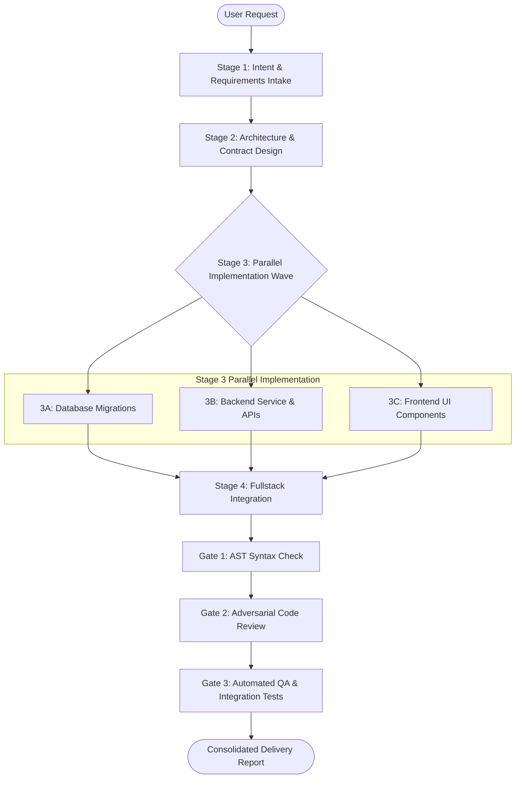

# Workflow: full-cycle-feature-development (CAN-WFL-01)

## 1. Purpose & Applicable Scenarios
- **Purpose**: Provides a robust, structured path for implementing non-trivial, multi-tier software features spanning requirements, architecture, persistence, business logic, and UI.
- **When to Use**: Building new functional features, major user stories, or multi-component capabilities requiring coordination across layers.
- **When NOT to Use**: Quick bug fixes (use `CAN-WFL-02`), documentation updates (use `CAN-WFL-07`), or standalone code reviews (use `CAN-WFL-03`).

## 2. Entry Conditions & Required Inputs
- **Entry Conditions**: High-level user feature request, Epic directive, or user problem statement.
- **Required Inputs**: Existing codebase context, technology manifest files, target milestone criteria.

## 3. Participating Agents & Skill Mapping

| Agent ID | Agent Name | Role in Workflow | Mapped Skills Used |
|:---:|---|---|---|
| `CAN-AGT-01` | `orchestrator` | Overall DAG planning, specialist delegation, lock coordination, gate enforcement | `ast-symbol-extractor`, `human-interruption-gateway` |
| `CAN-AGT-02` | `product-analyst` | Decomposing feature into SPIDR stories and acceptance criteria | `documentation-synthesizer` |
| `CAN-AGT-03` | `system-architect` | Designing component topology, data contracts, and ADRs | `documentation-synthesizer`, `api-contract-validator` |
| `CAN-AGT-06` | `database-specialist` | Authoring schema migrations, index optimization, and rollback scripts | `database-migration-linter`, `surgical-code-editor` |
| `CAN-AGT-04` | `backend-engineer` | Implementing server endpoints, business logic, and unit tests | `surgical-code-editor`, `ast-syntax-verifier`, `git-atomic-committer` |
| `CAN-AGT-05` | `frontend-engineer` | Implementing web UI components, client state, and responsive styling | `surgical-code-editor`, `ast-syntax-verifier`, `git-atomic-committer` |
| `CAN-AGT-07` | `fullstack-integrator` | Wiring frontend to backend APIs and validating data flow | `surgical-code-editor`, `api-contract-validator` |
| `CAN-AGT-10` | `syntax-verifier` | Pre/post-mutation AST syntax validation | `ast-syntax-verifier` |
| `CAN-AGT-09` | `code-reviewer` | Independent adversarial code review on git diffs | `ast-symbol-extractor`, `dead-code-detector` |
| `CAN-AGT-11` | `qa-engineer` | Integration/E2E test suite authoring and execution | `test-gap-analyzer`, `ephemeral-test-server`, `git-atomic-committer` |

## 4. Execution Stages & Dependency Graph

### Stage-by-Stage Breakdown
- **Stage 1: Requirements Intake (Mandatory)**
  - *Lead*: `product-analyst`
  - *Action*: Ingests user request, breaks down scope into SPIDR vertical slices, and defines testable Given/When/Then acceptance criteria.
- **Stage 2: Architecture & Contract Specification (Conditional)**
  - *Lead*: `system-architect`
  - *Condition*: Mandatory for new multi-component systems; **skipped** if feature extends an existing established API without contract modifications.
  - *Action*: Emits OpenAPI/JSON Schema contracts, Mermaid sequence diagrams, and ADRs.
- **Stage 3: Parallel Implementation Wave (Mandatory)**
  - *Lead*: `database-specialist` (3A), `backend-engineer` (3B), `frontend-engineer` (3C).
  - *Condition*: Branches are executed conditionally based on feature scope (e.g. backend-only tasks skip 3C; frontend-only tasks skip 3A/3B).
  - *Action*: Specialists modify code using `surgical-code-editor` under non-overlapping file reservation locks.
- **Stage 4: Fullstack Integration & Verification (Conditional)**
  - *Lead*: `fullstack-integrator`
  - *Condition*: Mandatory for fullstack features; skipped for single-tier modifications.
  - *Action*: Replaces mocks with live API calls and validates end-to-end data flow.
- **Stage 5: Verification & Gate Enforcement (Mandatory)**
  - *Lead*: `syntax-verifier` (Gate 1) -> `code-reviewer` (Gate 2) -> `qa-engineer` (Gate 3).
  - *Action*: Enforces conditional quality gates before deliverable is staged.

## 5. Parallel Execution Opportunities & Dynamic Adaptation
- **Parallelism**: Stage 3A (Database), 3B (Backend), and 3C (Frontend) execute concurrently once Stage 2 contracts are published.
- **Dynamic Specialist Skipping**: If a feature requires no persistence changes, `database-specialist` is omitted from the DAG. If API-only, `frontend-engineer` is omitted.
- **Dynamic Reordering**: If frontend mocks allow client development prior to backend availability, Stage 3C can begin immediately using contracts.

## 6. Handoffs, Blockers & Escalation Pathways
- **CAN-ENV-01 v2.2 Communication Protocol**: All handoffs, stage transitions, status updates, and task delegations pass strictly through `orchestrator` (`CAN-AGT-01`) using `CAN-ENV-01 v2.2` envelopes. No direct peer-to-peer agent bypass is permitted.
- **Blockers & Clarifications**: If an assigned specialist hits an impediment, unresolvable ambiguity, or defect, it emits a `BLOCKER` or `CLARIFICATION_REQUEST` envelope to `CAN-AGT-01`. The Orchestrator evaluates the blocker, pauses dependent stages, and either resolves it directly, requests human clarification, or reassigns the task.
- **Dynamic Task Reassignment & Cancellation**: If an agent fails to deliver or scope shifts, `CAN-AGT-01` issues `TASK_REASSIGNMENT` or `TASK_CANCELLATION` envelopes and updates the DAG dynamically without aborting the overall workflow.
- **Change Requests & Disagreements**: Any architectural or scope divergence triggers a `CHANGE_REQUEST` or `DISAGREEMENT` envelope routed to `CAN-AGT-01`.
- **Human Approval Escalation**: If migration involves dropping columns, destructive DDL, or live service changes, `database-specialist` halts and `CAN-AGT-01` triggers the Level 3 4-quadrant human approval gate.

## 7. Applicable Conditional Quality Gates
- **Gate 1 (AST Syntax)**: Enforced via `tools/lint_ast.py` (`ast-syntax-verifier`) across all modified files.
- **Gate 2 (Code Review)**: Enforced via `code-reviewer` on git diffs before QA testing.
- **Gate 3 (Automated Tests)**: Enforced via `qa-engineer` executing unit and integration test suites.
- *Skipped Gates*: External deployment and live cloud infrastructure provisioning.

## 8. Expected Outputs & Completion Criteria
- **Deliverables**: Production-ready source files, database migrations (if applicable), unit and integration tests, updated API docs.
- **Completion Criteria**: All acceptance criteria marked MET in CAN-ENV-01 completion envelope; zero syntax errors; zero unresolved review blockers; all tests passing.
