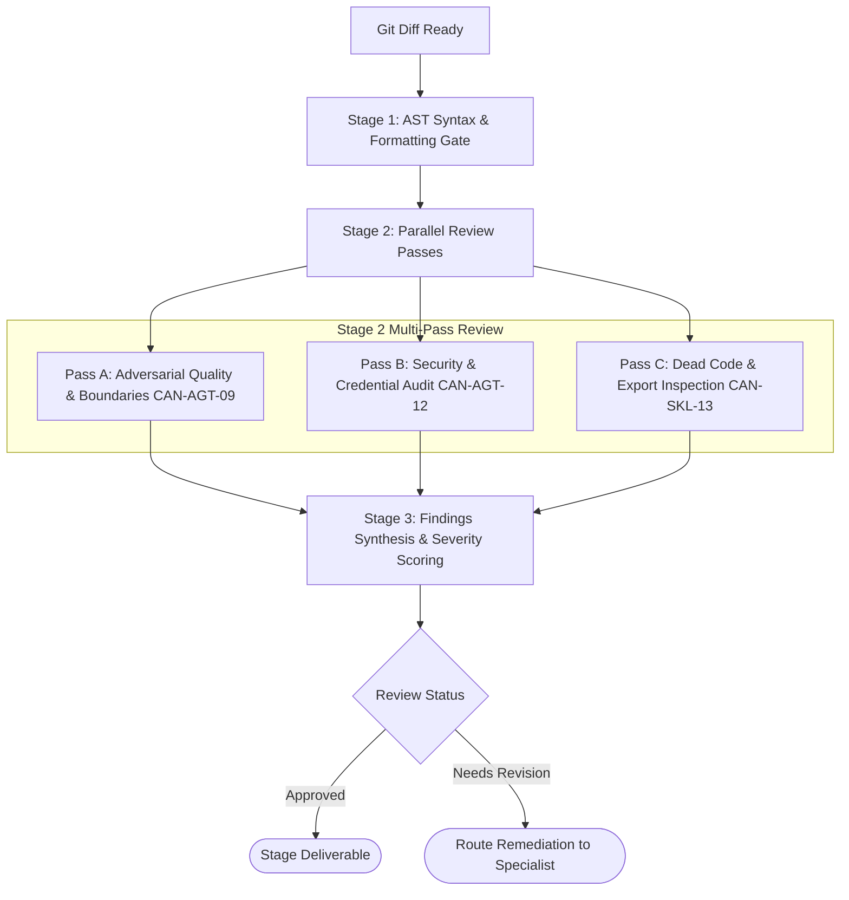

# Workflow: independent-adversarial-code-review (CAN-WFL-03)

## 1. Purpose & Applicable Scenarios
- **Purpose**: Provides an independent, objective review gate for code changes, ensuring functional correctness, security boundaries, and code health before merging.
- **When to Use**: Reviewing git diffs, evaluating pull requests, validating milestone deliverables, or pre-release release audits.
- **When NOT to Use**: Initial feature authoring (use `CAN-WFL-01`) or documentation-only updates (use `CAN-WFL-07`).

## 2. Entry Conditions & Required Inputs
- **Entry Conditions**: Code implementation complete and passing local unit tests.
- **Required Inputs**: Git diff (`git diff origin/main...HEAD`), modified files list, task acceptance criteria.

## 3. Participating Agents & Skill Mapping

| Agent ID | Agent Name | Role in Workflow | Mapped Skills Used |
|:---:|---|---|---|
| `CAN-AGT-01` | `orchestrator` | Dispatching review, ingesting findings, evaluating merge readiness | `human-interruption-gateway` |
| `CAN-AGT-09` | `code-reviewer` | Multi-pass adversarial code review, smell detection, findings compilation | `ast-symbol-extractor`, `pr-description-generator`, `dead-code-detector`, `ast-syntax-verifier` |
| `CAN-AGT-12` | `security-auditor` | Static security audit, secret scan, license compliance check | `security-secret-scanner`, `license-attribution-auditor` |
| `CAN-AGT-10` | `syntax-verifier` | Automated pre-review AST syntax validation | `ast-syntax-verifier` |

## 4. Execution Stages & Dependency Graph

### Stage-by-Stage Breakdown
- **Stage 1: Automated Syntax Verification (Mandatory)**
  - *Lead*: `syntax-verifier`
  - *Action*: Verifies that modified files contain zero parse or syntax errors via `tools/lint_ast.py`.
- **Stage 2: Multi-Pass Adversarial Review (Mandatory)**
  - *Lead*: `code-reviewer` and `security-auditor`
  - *Action*: Concurrently reviews code logic, error handling, edge cases, dead code (`dead-code-detector`), and credential leakage (`security-secret-scanner`).
- **Stage 3: Findings Synthesis & Severity Scoring (Mandatory)**
  - *Lead*: `code-reviewer`
  - *Action*: Compiles structured findings (`Blocking`, `Warning`, `Advisory`) with line numbers and suggested remediation code.

## 5. Parallel Execution Opportunities & Dynamic Adaptation
- **Parallel Passes**: Quality review (Pass A) and Security audit (Pass B) execute concurrently.
- **Specialist Skipping**: If diff touches zero dependencies, configuration files, or auth logic, `security-auditor` can run in lightweight mode or be skipped for internal docs.
- **Dynamic Reordering**: If high-priority syntax errors are caught in Stage 1, Stage 2 is skipped immediately to save compute until syntax is repaired.

## 6. Handoffs, Blockers & Escalation Pathways
- **CAN-ENV-01 v2.2 Communication Protocol**: All handoffs, stage transitions, status updates, and task delegations pass strictly through `orchestrator` (`CAN-AGT-01`) using `CAN-ENV-01 v2.2` envelopes. No direct peer-to-peer agent bypass is permitted.
- **Blockers & Clarifications**: If `code-reviewer` discovers ambiguous logic or undocumented assumptions, it emits `CLARIFICATION_REQUEST` to `CAN-AGT-01`.
- **Blocking Defects**: If `Blocking` findings are present in the `REVIEW_FINDING` envelope, `CAN-AGT-01` reassigns the remediation task back to the original authoring engineer.
- **Disagreement Resolution**: If author disputes a finding, it emits `DISAGREEMENT` to `CAN-AGT-01`, which mediates or prompts a human reviewer.
- **Human Approval Escalation**: When security audit uncovers potential vulnerabilities in public endpoints, `CAN-AGT-01` halts execution and presents the Level 3 human approval gate.

## 7. Applicable Conditional Quality Gates
- **Syntax Gate**: Zero AST syntax errors permitted.
- **Security Gate**: Zero high-entropy secret leaks permitted.
- **Dead Code Gate**: Zero orphaned test code or unreferenced exports.

## 8. Expected Outputs & Completion Criteria
- **Deliverables**: Comprehensive Code Review Report with status (`Approved`, `Needs Revision`, `Blocked`).
- **Completion Criteria**: Status is `Approved` with zero unresolved blocking issues.
