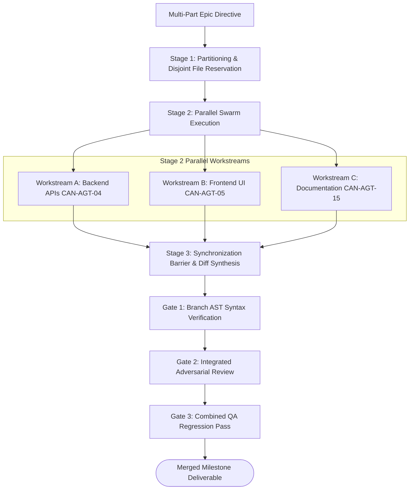

# Workflow: parallel-multi-agent-worktree-swarm (CAN-WFL-10)

## 1. Purpose & Applicable Scenarios
- **Purpose**: Enables high-throughput parallel execution across multiple specialist agents working on disjoint file sets or isolated git worktrees simultaneously.
- **When to Use**: Large multi-component tasks, batch file migrations, or independent cross-cutting deliverables (e.g. backend endpoint + frontend UI + user documentation).
- **When NOT to Use**: Highly coupled sequential tasks where each step depends on the output of the preceding step.

## 2. Entry Conditions & Required Inputs
- **Entry Conditions**: Multi-part milestone directive with disjoint, non-overlapping file dependencies.
- **Required Inputs**: Partitionable task list, file reservation boundary specifications.

## 3. Participating Agents & Skill Mapping

| Agent ID | Agent Name | Role in Workflow | Mapped Skills Used |
|:---:|---|---|---|
| `CAN-AGT-01` | `orchestrator` | Task partitioning, dynamic file reservation locking, branch synchronization | `human-interruption-gateway` |
| `CAN-AGT-04` | `backend-engineer` | Parallel execution of backend workstream | `surgical-code-editor`, `ast-syntax-verifier`, `git-atomic-committer` |
| `CAN-AGT-05` | `frontend-engineer` | Parallel execution of frontend workstream | `surgical-code-editor`, `ast-syntax-verifier`, `git-atomic-committer` |
| `CAN-AGT-15` | `docs-technical-writer` | Parallel execution of documentation workstream | `documentation-synthesizer`, `git-atomic-committer` |
| `CAN-AGT-10` | `syntax-verifier` | Per-branch syntax validation gate | `ast-syntax-verifier` |
| `CAN-AGT-09` | `code-reviewer` | Integrated diff review across merged workstreams | `ast-syntax-verifier` |
| `CAN-AGT-11` | `qa-engineer` | End-to-end regression validation of merged swarm deliverables | `git-atomic-committer`, `ephemeral-test-server` |

## 4. Execution Stages & Dependency Graph

### Stage-by-Stage Breakdown
- **Stage 1: Task Partitioning & Disjoint File Reservation (Mandatory)**
  - *Lead*: `orchestrator`
  - *Action*: Analyzes task dependencies, verifies zero file-lock overlap across assigned files, and grants exclusive write leases per branch/worktree.
- **Stage 2: Parallel Swarm Execution (Mandatory)**
  - *Lead*: Multiple assigned specialists (e.g. `backend-engineer`, `frontend-engineer`, `docs-technical-writer`).
  - *Action*: Specialists execute concurrently on their isolated workstreams, creating atomic commits via `git-atomic-committer`.
- **Stage 3: Synchronization Barrier & Diff Synthesis (Mandatory)**
  - *Lead*: `orchestrator`
  - *Action*: Waits for all active parallel workstreams to emit `TASK_COMPLETION`; synthesizes branch diffs and merges workstreams without conflicts.
- **Stage 4: Integrated Quality Verification (Mandatory)**
  - *Lead*: `syntax-verifier`, `code-reviewer`, `qa-engineer`
  - *Action*: Validates that combined deliverables pass syntax checks, code review, and end-to-end regression tests.

## 5. Parallel Execution Opportunities & Dynamic Adaptation
- **Maximum Concurrency**: Up to $N$ independent specialists execute simultaneously on disjoint file subsets.
- **Specialist Skipping**: Specialists not relevant to the specific swarm batch (e.g. `frontend-engineer` for backend-only batches) are omitted from the swarm.
- **Dynamic Lock Acquisition**: If an agent discovers during execution that it requires an additional file, it must request dynamic lock expansion from `orchestrator`. If contended, agent pauses until released.

## 6. Handoffs, Blockers & Escalation Pathways
- **CAN-ENV-01 v2.2 Communication Protocol**: All handoffs, stage transitions, status updates, and task delegations pass strictly through `orchestrator` (`CAN-AGT-01`) using `CAN-ENV-01 v2.2` envelopes. No direct peer-to-peer agent bypass is permitted.
- **Blockers & Clarifications**: If an agent encounters a lock contention or file barrier, it emits `BLOCKER` to `CAN-AGT-01`.
- **Dynamic Task Reassignment & Cancellation**: If one workstream is blocked or canceled, `CAN-AGT-01` issues `TASK_REASSIGNMENT` or `TASK_CANCELLATION` for that workstream without stalling independent parallel workstreams.
- **Merge Conflicts**: Because files are strictly partitioned into disjoint sets upfront, merge conflicts are structurally prevented. If unexpected conflicts occur, `orchestrator` pauses and assigns `surgeon-editor` to resolve.
- **Human Approval Escalation**: Final merge of a high-impact multi-agent workstream swarm into main triggers human notification and review.

## 7. Applicable Conditional Quality Gates
- **Per-Branch Syntax Gate**: Every individual workstream must pass `ast-syntax-verifier` before merging.
- **Integrated Review Gate**: Merged diff is reviewed as a unified release by `code-reviewer`.
- **Full Regression Gate**: Combined changes must pass full integration test suite via `qa-engineer`.

## 8. Expected Outputs & Completion Criteria
- **Deliverables**: Synthesized, conflict-free commit containing all parallel workstream deliverables; complete verification logs.
- **Completion Criteria**: All parallel workstreams complete; zero lock deadlocks; all combined integration tests pass.
