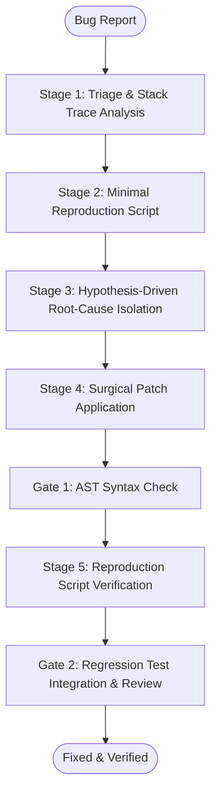

# Workflow: surgical-bug-investigation-and-fix (CAN-WFL-02)

## 1. Purpose & Applicable Scenarios
- **Purpose**: Rapidly investigates, reproduces, and repairs software bugs with zero speculative guesswork and minimal line-blast radius.
- **When to Use**: Broken unit tests, unhandled exceptions, runtime crashes, logical bugs, and customer-reported defects.
- **When NOT to Use**: Adding major new features (use `CAN-WFL-01`) or broad codebase refactoring (use `CAN-WFL-09`).

## 2. Entry Conditions & Required Inputs
- **Entry Conditions**: Bug report, error stack trace, failing test log, or unexpected behavioral anomaly.
- **Required Inputs**: Error logs, failing input parameters, target codebase.

## 3. Participating Agents & Skill Mapping

| Agent ID | Agent Name | Role in Workflow | Mapped Skills Used |
|:---:|---|---|---|
| `CAN-AGT-01` | `orchestrator` | Bug triage, dispatching investigator, monitoring repair verification | `human-interruption-gateway` |
| `CAN-AGT-13` | `debugger-detective` | Stack trace analysis, hypothesis formulation, minimal reproduction script | `semantic-code-search`, `ast-symbol-extractor`, `surgical-code-editor` |
| `CAN-AGT-04` | `backend-engineer` | Backend fault remediation (or `frontend-engineer` for client bugs) | `surgical-code-editor`, `ast-syntax-verifier`, `git-atomic-committer` |
| `CAN-AGT-08` | `surgeon-editor` | Applying deterministic, surgical code patch | `surgical-code-editor`, `ast-syntax-verifier` |
| `CAN-AGT-10` | `syntax-verifier` | Post-edit syntax validation | `ast-syntax-verifier` |
| `CAN-AGT-11` | `qa-engineer` | Converting reproduction script into permanent regression test | `git-atomic-committer`, `ephemeral-test-server` |
| `CAN-AGT-09` | `code-reviewer` | Reviewing patch diff for side effects | `ast-syntax-verifier` |

## 4. Execution Stages & Dependency Graph

### Stage-by-Stage Breakdown
- **Stage 1: Triage & Log Isolation (Mandatory)**
  - *Lead*: `debugger-detective`
  - *Action*: Analyzes stack trace, identifies failing module, and traces execution paths via `semantic-code-search`.
- **Stage 2: Minimal Reproduction Script (Mandatory)**
  - *Lead*: `debugger-detective`
  - *Action*: Authors a standalone test script that deterministically reproduces the defect. Fails with the reported error.
- **Stage 3: Root-Cause Isolation (Mandatory)**
  - *Lead*: `debugger-detective`
  - *Action*: Formulates falsifiable hypotheses, tests them, and locates the exact buggy lines.
- **Stage 4: Surgical Patch Application (Mandatory)**
  - *Lead*: `surgeon-editor` or `backend-engineer`/`frontend-engineer`
  - *Action*: Applies targeted, character-exact replacement using `surgical-code-editor`.
- **Stage 5: Verification & Regression Inclusion (Mandatory)**
  - *Lead*: `qa-engineer`
  - *Action*: Re-runs reproduction script to verify fix passes; converts reproduction script into permanent test suite regression case.

## 5. Parallel Execution Opportunities & Dynamic Adaptation
- **Specialist Skipping**: If bug is trivial (e.g. typos, off-by-one errors with obvious root cause), `debugger-detective` can directly invoke `surgeon-editor` and skip extended hypothesis cycles.
- **Adaptive Routing**: Server-side bugs invoke `backend-engineer`; client-side UI bugs invoke `frontend-engineer`.
- **Dynamic Reordering**: If a clean reproduction already exists in test logs, Stage 2 is skipped and root-cause isolation begins immediately.

## 6. Handoffs, Blockers & Escalation Pathways
- **CAN-ENV-01 v2.2 Communication Protocol**: All handoffs, stage transitions, status updates, and task delegations pass strictly through `orchestrator` (`CAN-AGT-01`) using `CAN-ENV-01 v2.2` envelopes. No direct peer-to-peer agent bypass is permitted.
- **Blockers & Clarifications**: If `debugger-detective` cannot reproduce the bug after 3 hypothesis iterations, it emits a `BLOCKER` envelope to `CAN-AGT-01`, which requests diagnostic telemetry or user clarification.
- **Dynamic Task Reassignment & Cancellation**: If investigation reveals the defect is in a third-party package or upstream service, `CAN-AGT-01` reassigns the task or initiates research via `CAN-WFL-04`.
- **Human Approval Escalation**: If the proposed patch requires breaking changes to existing data contracts or API schemas, `CAN-AGT-01` halts execution and presents the Level 3 human gate.

## 7. Applicable Conditional Quality Gates
- **Gate 1 (Syntax)**: Sub-second syntax verification via `tools/lint_ast.py`.
- **Gate 2 (Reproduction Pass)**: Reproduction script MUST pass cleanly on the patched code.
- **Gate 3 (Review)**: Lightweight review by `code-reviewer` (skipped if patch is <= 3 lines and passes regression test).

## 8. Expected Outputs & Completion Criteria
- **Deliverables**: Root-cause diagnostic note, surgically patched file, permanent regression test case.
- **Completion Criteria**: Reproduction script passes; zero regressions in existing test suite; syntax verified.
