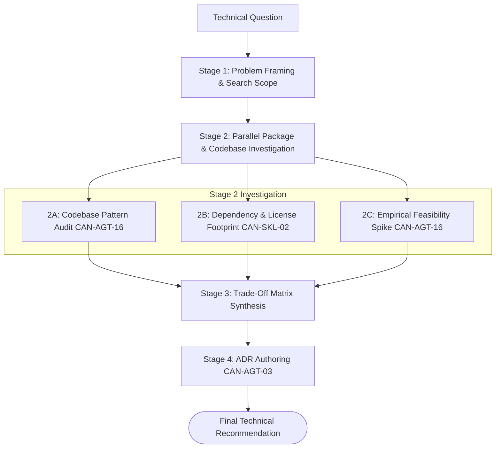

# Workflow: technical-research-and-spike (CAN-WFL-04)

## 1. Purpose & Applicable Scenarios
- **Purpose**: Systematically evaluates technical options, evaluates third-party packages, explores unfamiliar codebases, and produces empirical comparison dossiers.
- **When to Use**: Onboarding new repositories, selecting third-party libraries, evaluating migration feasibility, or resolving architectural uncertainty.
- **When NOT to Use**: Routine feature coding with established libraries (use `CAN-WFL-01`).

## 2. Entry Conditions & Required Inputs
- **Entry Conditions**: Technical question, architecture dilemma, or candidate package selection request.
- **Required Inputs**: Evaluation criteria, candidate library names/links, constraints.

## 3. Participating Agents & Skill Mapping

| Agent ID | Agent Name | Role in Workflow | Mapped Skills Used |
|:---:|---|---|---|
| `CAN-AGT-01` | `orchestrator` | Framing research goals, reviewing trade-offs, deciding downstream DAG | `project-dependency-analyzer` |
| `CAN-AGT-16` | `research-investigator` | Codebase exploration, package benchmarking, trade-off matrix authoring | `semantic-code-search`, `ast-symbol-extractor`, `project-dependency-analyzer` |
| `CAN-AGT-03` | `system-architect` | Translating research findings into Architecture Decision Records (ADRs) | `documentation-synthesizer` |
| `CAN-AGT-17` | `data-analyst` | Benchmarking performance metrics, memory overhead, or telemetry data | `documentation-synthesizer`, `project-dependency-analyzer` |

## 4. Execution Stages & Dependency Graph

### Stage-by-Stage Breakdown
- **Stage 1: Problem Framing & Criteria Definition (Mandatory)**
  - *Lead*: `orchestrator` and `research-investigator`
  - *Action*: Defines evaluation criteria (performance, license compatibility, maintenance health, bundle size).
- **Stage 2: Investigation & Feasibility Spikes (Mandatory)**
  - *Lead*: `research-investigator`
  - *Action*: Audits existing code patterns via `ast-symbol-extractor` and dependencies via `project-dependency-analyzer`.
- **Stage 3: Trade-Off Matrix Synthesis (Mandatory)**
  - *Lead*: `research-investigator`
  - *Action*: Compiles structured comparison matrix with factual evidence and empirical rankings.
- **Stage 4: ADR Authoring (Conditional)**
  - *Lead*: `system-architect`
  - *Condition*: Mandatory if research adoption results in a binding architectural decision; skipped for informational audits.
  - *Action*: Drafts formal Architecture Decision Record using `documentation-synthesizer`.

## 5. Parallel Execution Opportunities & Dynamic Adaptation
- **Parallel Audits**: Multiple candidate libraries are investigated concurrently across Stage 2A, 2B, and 2C.
- **Specialist Skipping**: If research is purely descriptive without quantitative metrics, `data-analyst` is omitted from the DAG.
- **Dynamic Reordering**: If an empirical spike in Stage 2C immediately proves infeasible due to fatal constraints, remaining audits are cancelled early.

## 6. Handoffs, Blockers & Escalation Pathways
- **CAN-ENV-01 v2.2 Communication Protocol**: All handoffs, stage transitions, status updates, and task delegations pass strictly through `orchestrator` (`CAN-AGT-01`) using `CAN-ENV-01 v2.2` envelopes. No direct peer-to-peer agent bypass is permitted.
- **Blockers & Clarifications**: If candidate documentation is missing or contradictory, `research-investigator` emits `CLARIFICATION_REQUEST` to `CAN-AGT-01`.
- **License Incompatibility**: If candidate library is licensed under GPL/AGPL in a commercial project, `research-investigator` emits `BLOCKER` to `CAN-AGT-01`, which drops the candidate immediately.
- **Human Approval Escalation**: When research proposes adopting an entirely new core framework or runtime dependency, `CAN-AGT-01` escalates to the human user for approval.

## 7. Applicable Conditional Quality Gates
- **Research Dossier Gate**: Must contain factual citations, license verification, and explicit trade-off comparisons.
- *Skipped Gates*: Code review pipeline, QA test runners, browser test runners (informational workflow).

## 8. Expected Outputs & Completion Criteria
- **Deliverables**: Technical research dossier, comparison table, Architecture Decision Record (ADR).
- **Completion Criteria**: Clear, evidence-backed recommendation delivered to `orchestrator`.
