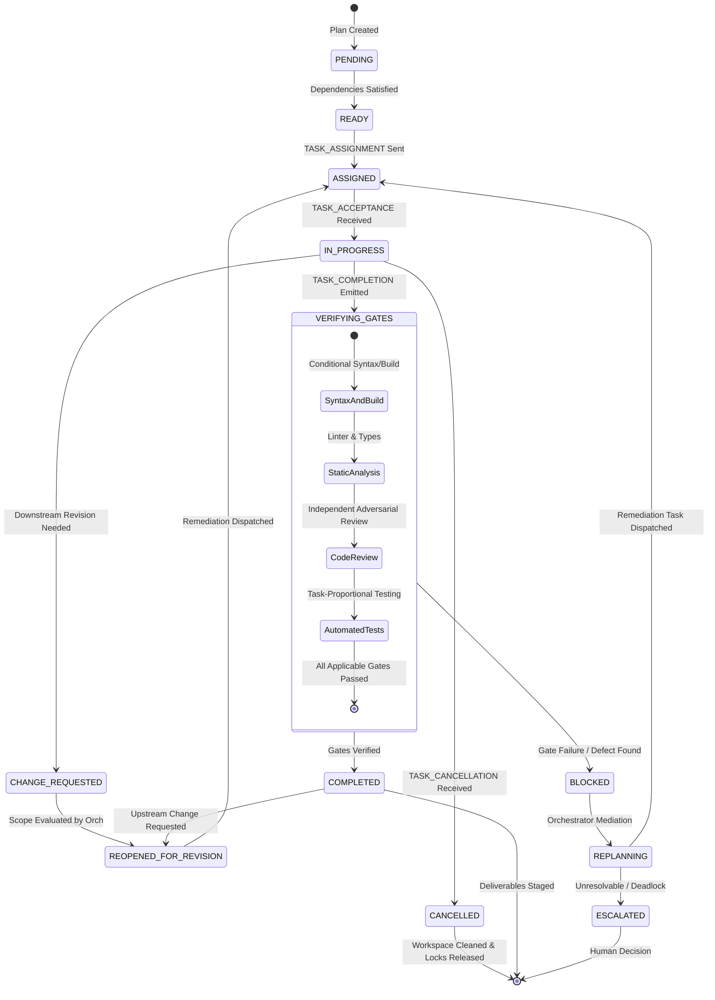

# Execution Lifecycle, Concurrency & Recovery (Refined Phase 1A.1)

## 1. Task Lifecycle State Machine

Every task node managed by the Orchestrator advances through a deterministic finite state machine (FSM):



---

## 2. Dynamic File Reservation, Conflict Resolution & Deadlock Prevention

### A. Deadlock-Free Dynamic Write-Lock Protocol (Two-Phase Acquire):
When parallel agents discover mid-execution that an unexpected file must be modified, acquiring locks naively can introduce a classic circular deadlock:
- *Agent A holds Lock 1 (`src/api/auth.py`) and attempts to acquire Lock 2 (`src/main.py`).*
- *Agent B holds Lock 2 (`src/main.py`) and attempts to acquire Lock 1 (`src/api/auth.py`).*

To guarantee that dynamic file-lock acquisition **mathematically cannot introduce deadlocks**, our architecture enforces the **Atomic Two-Phase Dynamic Re-Acquisition Protocol**:

```mermaid
sequenceDiagram
    autonumber
    actor Worker as Specialist Agent A
    actor Orch as Central Orchestrator
    participant LockReg as .agent/locks.json

    Note over Worker: Discovers unexpected dependency: File 2
    Note over Worker: Currently holds lease on: File 1
    Worker->>Orch: CAN-ENV-01 (REQUEST_ADDITIONAL_LOCK: [File 2])
    
    Note over Orch: Computes new combined lock set: [File 1, File 2]
    Note over Orch: Sorts combined set ALPHABETICALLY: [File 1, File 2]
    
    alt File 2 is already locked by Agent B
        Note over Orch: Contention detected!
        Orch-->>Worker: Lock unavailable; must yield to prevent deadlock
        Worker->>LockReg: Surrenders leased File 1 (Release Phase)
        Note over Worker: Enters backoff queue with jittered sleep
        Worker->>Orch: Re-attempts sorted acquisition of [File 1, File 2]
    else File 2 is free
        Note over Orch: Atomically extends lease to include File 2
        Orch->>LockReg: Updates lease registry
        Orch-->>Worker: Lock granted: [File 1, File 2]
        Note over Worker: Continues safe atomic mutation
    end
```

#### The 3 Invariants of Deadlock-Free Dynamic Locking:
1. **Alphabetical Total Ordering**: All lock sets (both initial and expanded) are sorted lexicographically before acquisition.
2. **Release-on-Contention (No Hold-and-Wait)**: If an agent currently holding Lock X attempts to acquire newly discovered Lock Y, and Lock Y is currently leased by another task, the agent **MUST release Lock X and enter a randomized exponential backoff queue**. It cannot "hold X while waiting indefinitely for Y".
3. **Atomic Multi-Lock Leases**: The Orchestrator evaluates the combined lock request `[X, Y]` as a single atomic operation in `.agent/locks.json`. Locks are granted together or rejected together.

---

## 3. Failure, Timeout, Cancellation & Recovery Matrix

| Failure Condition | Detection Mechanism | Automated Recovery Strategy | Max Retries | Fallback / Human Escalation Trigger |
|---|---|---|:---:|---|
| **Syntax Error Post-Edit** | `CAN-SKL-03` Tree-sitter linter detects AST error. | Immediate surgical repair dispatched to `surgeon-editor` with line context. | 3 | Halt execution; trigger 4-quadrant prompt with `allow_edit`. |
| **Compiler / Build Failure** | Native compiler (`tsc`, `cargo`, `go build`) exit != 0. | Route compiler error diagnostics and stack trace to author agent. | 2 | Escalate to `debugger-detective` for deep root-cause hypothesis generation. |
| **Code Review Defect Flagged** | `code-reviewer` emits `REVIEW_FINDING`. | Generate structured revision envelope with line citations; route to author agent. | 2 | Escalate to `system-architect` or human for design arbitration. |
| **QA Test Assertion Failure** | Unit/E2E test assertion fails. | Capture assertion failure; route to author for regression fix. | 2 | Halt deployment; notify user with complete test logs. |
| **Circular Dependency Deadlock** | Cycle detection algorithm on execution DAG flags loop. | Break cycle by introducing a synthetic mock contract interface. | 0 (Instant) | Halt execution immediately; prompt human for architectural decision. |
| **Agent Execution Timeout** | Turn count exceeds 15 or subagent process hangs. | Issue `TASK_CANCELLATION`; rollback workspace to last clean checkpoint; reassign task. | 1 | Escalate task failure to user with diagnostic logs. |
| **Cascading Task Cancellation** | Upstream task fails permanently or is cancelled by user. | Orchestrator dispatches `TASK_CANCELLATION` to all active child tasks; validates rollback and releases locks. | N/A | Clean workspace verified before returning control to user. |
| **Dynamic Lock Contention Backoff**| Newly discovered file lock is held by another active agent. | Agent surrenders existing locks, enters jittered backoff, and re-requests sorted full set. | 3 | If contention persists, Orchestrator queues task sequentially. |
