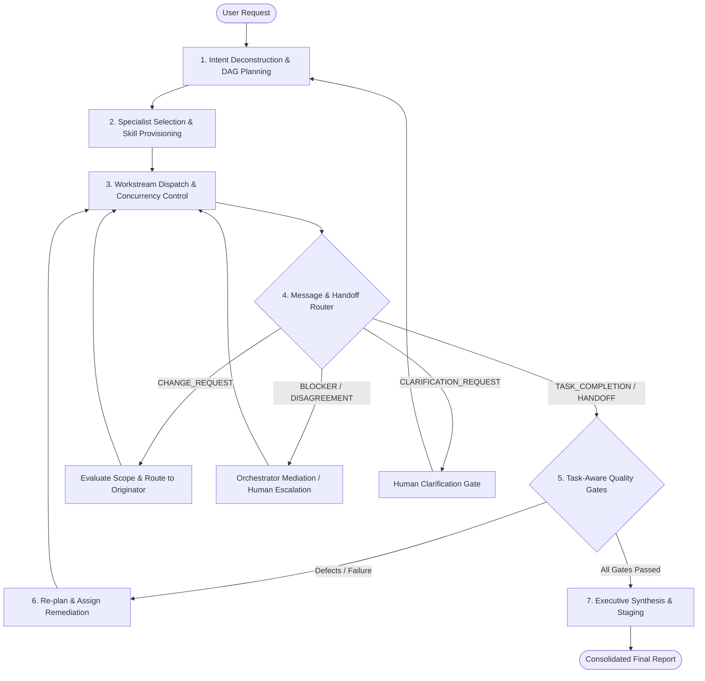
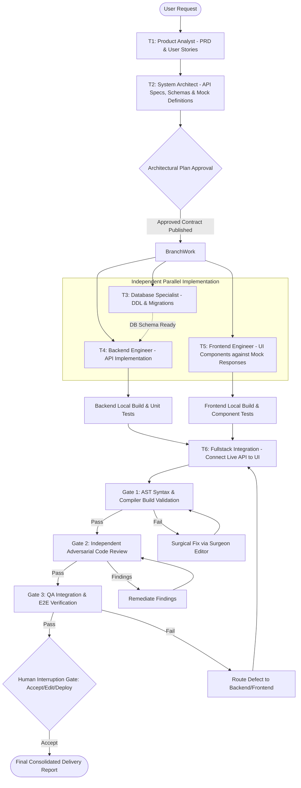

# Orchestrator Architecture (Refined Phase 1A.1)

## 1. Executive Summary & Design Mission

The **Orchestrator Agent (`CAN-AGT-01`)** is the central entry point and meta-coordinator of the Universal AI Agent Army.

### Core Architectural Axiom:
*The Orchestrator coordinates; it does NOT execute specialist domain work.*

The Orchestrator maintains global task state, interprets user intent, formulates dynamic task DAGs, provisions skills, delegates atomic tasks, mediates two-way collaboration between agents, resolves blockers and disagreements, enforces task-aware quality gates, and synthesizes executive status reports.

### Bounded Operational Scope:
- **Authorized Orchestrator Operations**:
  - Task intent deconstruction and ambiguity clarification with the user.
  - Generating and dynamically updating execution DAGs.
  - Selecting and dispatching specialist agents.
  - Tracking task states and maintaining execution logs in `.agent/state.json`.
  - Ingesting, validating, and routing inter-agent handoff envelopes (`CAN-ENV-01`).
  - Evaluating and routing `CHANGE_REQUEST`, `BLOCKER`, and `DISAGREEMENT` messages.
  - Triggering independent verification gates (Code Review, QA, AST Lint, Build).
  - Presenting consolidated executive delivery reports.
- **Strictly Prohibited Operations**:
  - Writing application business logic or modifying domain source code.
  - Creating or executing database migrations directly.
  - Self-certifying or independently approving code changes.
  - Silently suppressing test failures or skipping quality gates.

---

## 2. Core Functional Responsibilities & Decision Flow

---

## 3. Dynamic Parallel Dependency Model: Customer Management Example

To illustrate the corrected dependency and parallel execution architecture, consider the user prompt:
> *"Build a customer management module with backend APIs, database changes and a frontend."*

### True Parallelism via Contract Decoupling:
Frontend engineering does **not** wait for full backend code completion. Once the **System Architect** publishes and locks the typed API contract and mock schema, the **Frontend Developer** immediately begins building UI components and mock integration in parallel with the **Backend Developer** and **Database Specialist**.

---

## 4. Two-Way Collaboration & Mediation

The Orchestrator actively mediates inter-agent interactions through structured messages:
1. **Handling Change Requests**: When `frontend-engineer` identifies a missing field in the API, it emits a `CHANGE_REQUEST`. The Orchestrator assesses project scope, approves or adjusts the request, and dispatches a task update to `backend-engineer`.
2. **Resolving Disagreements**: If two agents disagree on an architectural approach (e.g. database schema normalization vs JSON column storage), the Orchestrator assigns `system-architect` (`CAN-AGT-03`) to make an authoritative Architectural Decision Record (`ADR`).
3. **Preventing Deadlocks**: The Orchestrator monitors dependency graphs for circular waits. If an unresolvable circular dependency is detected, execution is halted, state is checkpointed, and the conflict is escalated to the human user.
