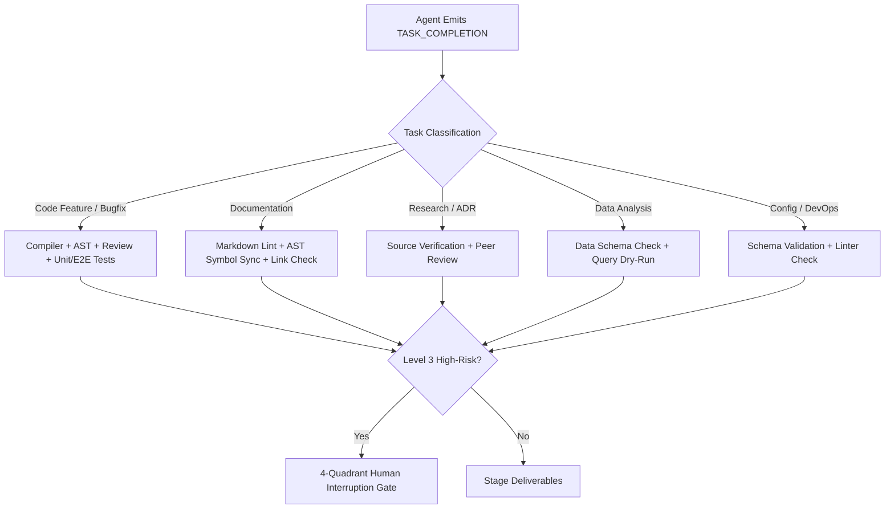

# Safety, Quality Gates & Approval Policy (Refined Phase 1A.1)

## 1. Executive Summary & Verification Philosophy

Autonomous coding agents must never be allowed to "self-certify" their own work, nor should verification be applied with a one-size-fits-all hammer.

### Core Principles:
1. **Decoupled Verification**: The authoring agent cannot act as its own code reviewer or QA tester.
2. **Language- and Project-Aware Gates**: Tree-sitter AST validation is an essential lightweight syntax check, but it **never replaces the project's actual compiler, type-checker, or test harness**.
3. **Proportional Quality Gates**: Quality gates are strictly conditional on the task type and project technology. **Non-code tasks (research, documentation, data analysis) MUST NOT be subjected to compiler or E2E test gates.**

---

## 2. Conditional Quality Gate Matrix by Task Type

### Granular Applicability Matrix:

| Task Category | Applicable Quality Gates | Primary Validation Tools | Excluded / Non-Applicable Gates |
|---|---|---|---|
| **Software Feature / API** | - Gate 1A (Tree-sitter AST) - Gate 1B (Compiler/Build) - Gate 2 (Linter/Type-Check) - Gate 3 (Code Review) - Gate 4A (Unit Tests) - Gate 4B (Integration Tests) | `tsc`, `cargo`, `go build`, `pytest`, `eslint`, `CAN-SKL-03` | Gate 4C (E2E Playwright tests excluded if no UI components involved) |
| **Frontend UI Feature** | - Gate 1A (AST Syntax) - Gate 1B (TypeScript build) - Gate 3 (Code Review) - Gate 4A (Component Tests) - Gate 4C (Playwright E2E Tests) | `vitest`, `playwright`, `CAN-SKL-09` | Backend integration gates (until fullstack integration step) |
| **Documentation & Docs Drift** | - Markdown linting - Broken link validation - Code-reality symbol sync (`CAN-SKL-17`) | `scan_ast.py`, markdown-link-check | Compiler builds, unit test runners, E2E test suites |
| **Technical Research & Spikes** | - Source URL verification - Peer review by `system-architect` - License compliance check | Web search validation, markdown lint | Compilers, unit test runners, AST linters |
| **Data Analysis & Scripting** | - Analytical SQL dry-run - Schema column validation - Script syntax check | `python -m py_compile`, SQL EXPLAIN | E2E Playwright tests, UI component tests |
| **Database Migrations** | - Migration dry-run - Rollback test execution - Index optimization review | Database migration runner, SQL linter | E2E Playwright tests, frontend UI tests |

---

## 3. Strict 3-Tier Permission Hierarchy

- **Level 1 (Read-Only Autonomous)**: Code search, AST symbol scanning, dependency analysis, planning, web research. Sandboxed.
- **Level 2 (Controlled Modifications)**: Editing files via `str_replace`, compiling, running local unit tests. Monitored with AST validation.
- **Level 3 (High-Risk Operations)**: `git push`, branch deletion, drops/truncates, changing credentials, triggering external deployments. Requires explicit human approval.

### Mandatory Rules of Conduct:
- AI agents are strictly forbidden from touching or forging the `HUMAN:` validation section in PR descriptions.
- Never delete or disable failing test assertions to force green builds.
- Commit messages must use `git commit -F <file>` to prevent persistent shell corruption.
