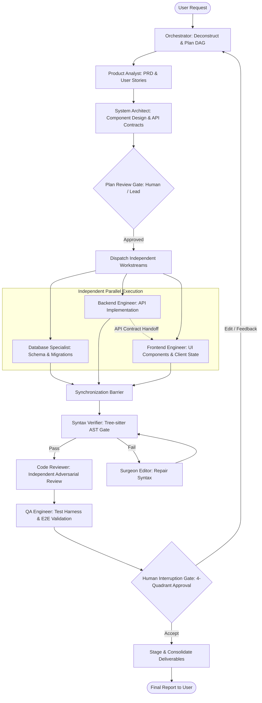

# Workflow Consolidation Matrix

## 1. Executive Summary & Design Principle

Multi-agent coordination fails when collaboration patterns are ad-hoc or purely conversational. 

By analyzing the 10 audited repositories, we discovered that successful systems rely on **formal state transitions, clear artifact deliverables, and independent verification gates**.

We consolidate the workflows from across the repositories into **10 Reusable Cognitive Workflows**, coordinated by the central Orchestrator.

---

## 2. Master Workflow Catalog (10 Reusable Workflows)

| Canonical ID | Workflow Name | Category | Primary Purpose & Phases | Originating Heritage |
|---|---|---|---|---|
| **CAN-WFL-01** | **Full-Cycle Feature Development** | Engineering | Requirements -> Architecture -> DB -> Backend -> Frontend -> Review -> QA -> Merge. | MetaGPT SOP (`WFL-007`) & LangGraph Plan-and-Execute (`WFL-008`). |
| **CAN-WFL-02** | **Surgical Bug Investigation & Fix** | Reliability | Triage -> Reproduce Test -> Hypothesis Root-Cause -> Surgical Edit -> AST Verify -> QA. | LangGraph Reflexion + OpenHands ACI (`SKL-014`). |
| **CAN-WFL-03** | **Independent Adversarial Code Review**| Quality Gate | Git Diff Isolation -> Static Analysis -> AST Check -> Security Audit -> Review Findings Report. | VoltAgent `surgeon-reviewer` + OpenHands `custom-codereview`. |
| **CAN-WFL-04** | **Technical Research & Spike** | Discovery | Problem Definition -> Source Ingestion -> Experiment Spike -> Trade-off Matrix -> ADR. | Anthropics `skill-creator` + Awesome Copilot `scan.py`. |
| **CAN-WFL-05** | **Architecture Decision & System Design**| Architecture | Requirements Ingestion -> Topology Design -> Mermaid Diagramming -> Contract Spec -> ADR. | MetaGPT `write_prd` / `design_api` + Awesome Copilot `adr-gen`. |
| **CAN-WFL-06** | **Database Schema & Migration Lifecycle**| Data Engineering | Data Modeling -> Migration Scripting -> Seed Data -> Rollback Test -> Performance Index Review. | VoltAgent `database-engineer` + LangGraph Human Gate. |
| **CAN-WFL-07** | **Documentation & Drift Remediation**| Documentation | AST Symbol Scan -> Doc Reality Check -> Drift Detection -> Markdown Update -> Link Validation. | VoltAgent `docs-drift-editor` + Awesome Copilot `acquire-codebase`. |
| **CAN-WFL-08** | **Application Security & Vulnerability Audit**| Security | Secret Scan -> Dependency CVE Audit -> SAST Code Analysis -> Threat Model -> Remediation Plan. | Ruflo `sec-guard` + VoltAgent `security-auditor`. |
| **CAN-WFL-09** | **Automated Test Suite Expansion** | Quality Gate | Test Gap Discovery -> Fixture Setup -> Happy Path -> Edge/Boundary Tests -> Coverage Verification. | MetaGPT `write_test` + Anthropic `webapp-testing`. |
| **CAN-WFL-10** | **Parallel Multi-Agent Worktree Swarm** | Concurrency | Task Splitting -> Git Worktree Isolation -> Parallel Execution -> Diff Synthesis -> Staged Merge. | Ruflo `WFL-006` Worktree Swarm Protocol. |

---

## 3. Workflow Specification: CAN-WFL-01 (Full-Cycle Feature Development)

